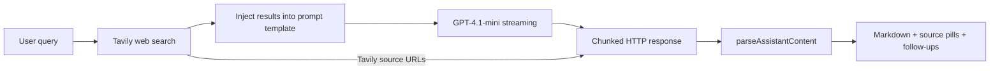

# webster-agent

A full-stack, web-search-augmented AI chat application. User queries are answered in real time by combining live web search results (via Tavily) with GPT-4.1-mini streaming responses — similar in spirit to Perplexity. Conversations are persisted per user, with source links and AI-generated follow-up questions surfaced after each response.

---

## Features

- **Real-time web search** — Tavily (advanced depth) fetches live results before every response
- **Streaming responses** — GPT-4.1-mini streams over a chunked HTTP response
- **Source links** — Tavily result URLs are appended to the stream by the server and rendered as pills below the answer
- **Follow-up questions** — the model generates suggested follow-ups after each answer; clicking one replays the full conversation history for context continuity
- **Auth** — Google and GitHub OAuth via Supabase; JWT validated on protected backend routes (`/health` is public)
- **Conversation persistence** — all conversations and messages stored in PostgreSQL via Prisma; active conversation synced to URL (`?id=...`) for deep-linking
- **Per-user rate limiting** — DB-backed fixed-window limits (daily + per-minute) protect API spend; breaches return HTTP 429
- **Themes** — 6 handcrafted themes (Default, Amethyst, Kodama, Cosmic, Amber, Solar Dusk), each with light and dark variants, applied via CSS custom properties and persisted to localStorage

---

## Architecture

```
Frontend (Vite + React SPA)
  │
  ├── Auth ──> Supabase OAuth (Google / GitHub)
  │
  └── Dashboard
        ├── Sidebar — conversation list, search, theme picker, logout
        ├── Chat area — streaming messages, source pills, follow-up buttons
        └── Input bar — ask / stop
              │
              └── fetch / axios ──> Express backend (:3001)
                                      │
                                      ├── middleware.ts
                                      │    └─ Validates Supabase JWT, upserts User into DB
                                      │
                                      ├── POST /webster/ask
                                      │    ├─ Tavily search (advanced depth)
                                      │    ├─ Inject results + query into prompt template
                                      │    ├─ OpenAI streaming (gpt-4.1-mini)
                                      │    ├─ Chunked HTTP response with custom XML tags
                                      │    └─ Persist User + Assistant messages to DB
                                      │
                                      ├── POST /webster/follow-up
                                      │    └─ Same as /ask, includes full message history
                                      │
                                      ├── GET /conversations
                                      ├── GET /conversation/:id
                                      │
                                       └── Prisma ORM ──> PostgreSQL
                                            (User, Conversation, Message, RateLimit)
```

### Data flow



---

## Key Technical Decisions

**Streaming via chunked HTTP over Express**
The backend writes chunks directly via `res.write()` with `text/event-stream` headers. It is not full SSE framing: the body is raw text plus custom XML tags. The tags let the frontend parse out-of-band metadata without a separate request.

**Structured LLM output via XML tags**
Instead of function calling or structured outputs, the system prompt instructs GPT-4.1-mini to wrap its answer in `<ANSWER>` and its follow-up questions in `<FOLLOW_UPS>`. The server appends `<SOURCES>` after the model stream. `parseAssistantContent.ts` uses regex to decompose the response into these parts; it matches complete tag pairs, so partial tags can briefly appear while streaming.

**Prompt templating**
Web search results and the user query are injected into a prompt template via string `.replace()`. The system prompt explicitly tells the model it has no tools — all context is provided upfront.

**Supabase for auth only**
Supabase handles OAuth and JWT validation. The actual data storage is a separate PostgreSQL database accessed through Prisma (`@prisma/adapter-pg`). User records are upserted on each authenticated request by matching `supabaseId`.

**Conversation history for follow-ups**
The `/follow-up` endpoint replays the full message history as prior context in the OpenAI `messages` array, enabling multi-turn continuity without storing embeddings.

**URL-based conversation state**
The active conversation ID is synced to URL search params (`?id=...`) and restored on page load, enabling deep-linkable conversations for the signed-in owner.

**DB-backed per-user rate limiting**
The `RateLimit` model stores per-user counters for a fixed-window daily cap and a per-minute burst cap. Both `/webster/ask` and `/webster/follow-up` go through the limiter, which creates the row if missing, locks it with `SELECT ... FOR UPDATE`, then increments and checks the counters. This makes increments atomic per user and prevents rejected requests from consuming quota. Limits are tunable via `RATE_LIMIT_DAILY` / `RATE_LIMIT_PER_MIN` and are read at server startup.

---

## Tech Stack

| Layer         | Technology                                             |
| ------------- | ------------------------------------------------------ |
| Frontend      | React 19, TypeScript, Vite 8, Tailwind CSS 4           |
| UI Components | shadcn (Radix UI), lucide-react                        |
| Backend       | Node.js, Express 5, TypeScript (tsx runner)            |
| Database      | PostgreSQL via Prisma 7.8 (`@prisma/adapter-pg`)       |
| Auth          | Supabase Auth — Google + GitHub OAuth, `@supabase/ssr` |
| AI            | OpenAI API (`gpt-4.1-mini`, streaming)                 |
| Search        | Tavily API (advanced web search)                       |
| Routing       | react-router-dom 7                                     |
| Markdown      | react-markdown, remark-gfm, rehype-raw                 |

---

## Data model

| Model          | Key fields                                                             | Notes                                                      |
| -------------- | ---------------------------------------------------------------------- | ---------------------------------------------------------- |
| `User`         | `id`, `email`, `provider`, `name`, `supabaseId`                        | `email` and `supabaseId` are unique                        |
| `Conversation` | `id`, `title`, `slug`, `userId`                                        | `slug` is unique; belongs to a `User`                      |
| `Message`      | `id`, `content`, `role`, `conversationId`, `createdAt`                 | Belongs to a `Conversation`; role is `User` or `Assistant` |
| `RateLimit`    | `id`, `userId`, `dailyCount`, `dailyReset`, `burstCount`, `burstReset` | `userId` is unique; no foreign key to `User`               |

Relationships are one-to-many: a user has many conversations, and a conversation has many messages.

---

## Setup

### Prerequisites

- Node.js 20.11+
- PostgreSQL database
- Supabase project (for OAuth)
- OpenAI API key
- Tavily API key

### Environment Variables

**Backend** — create `.env` in `/backend`:

```env
DATABASE_URL=your_postgresql_connection_string
SUPABASE_URL=your_supabase_project_url
SUPABASE_API_SECRET=your_supabase_api_secret
OPENAI_API_KEY=your_openai_api_key
TAVILY_API_KEY=your_tavily_api_key

# optional — defaults shown
CORS_ORIGIN=http://localhost:5173
RATE_LIMIT_DAILY=50
RATE_LIMIT_PER_MIN=10
# PORT=3001
```

**Frontend** — create `.env` in `/frontend`:

```env
VITE_SUPABASE_URL=your_supabase_project_url
VITE_SUPABASE_PUBLISHABLE_KEY=your_supabase_publishable_key
VITE_BACKEND_URL=http://localhost:3001
```

### Running Locally

```bash
# Backend
cd backend
npm install
npm run prisma:generate
npm run prisma:migrate
npm start

# Frontend (separate terminal)
cd frontend
npm install
npm run dev
```

Frontend runs on `http://localhost:5173`, backend on `http://localhost:3001`.

---

## Deployment

- **Frontend** — Vercel (root directory `frontend`, Vite). Set `VITE_SUPABASE_URL`, `VITE_SUPABASE_PUBLISHABLE_KEY`, and `VITE_BACKEND_URL` (no trailing slash) **before** the first build; Vite inlines `VITE_*` at build time.
- **Backend** — Render (root directory `backend`, Node 22). Build: `npm install && npx prisma generate`; start: `npm start`. Env: `DATABASE_URL` (Supabase transaction pooler), `SUPABASE_URL`, `SUPABASE_API_SECRET`, `OPENAI_API_KEY`, `TAVILY_API_KEY`, `RATE_LIMIT_DAILY`, `RATE_LIMIT_PER_MIN`. Set `CORS_ORIGIN` to the Vercel URL.
- **Keep-alive** — Render's free tier spins the backend down after 15 minutes idle (first request then waits ~30s to boot). `GET /health` returns `200 {"status":"ok"}` and exists only so an external monitor can keep the instance warm. **UptimeRobot** (free) monitors `https://<render-url>/health` every 5 minutes; the requests reset the idle timer. Don't delete `/health` or the monitor — the app depends on both.

---

<!-- ## Screenshots -->

<!-- TODO: Add screenshots -->
